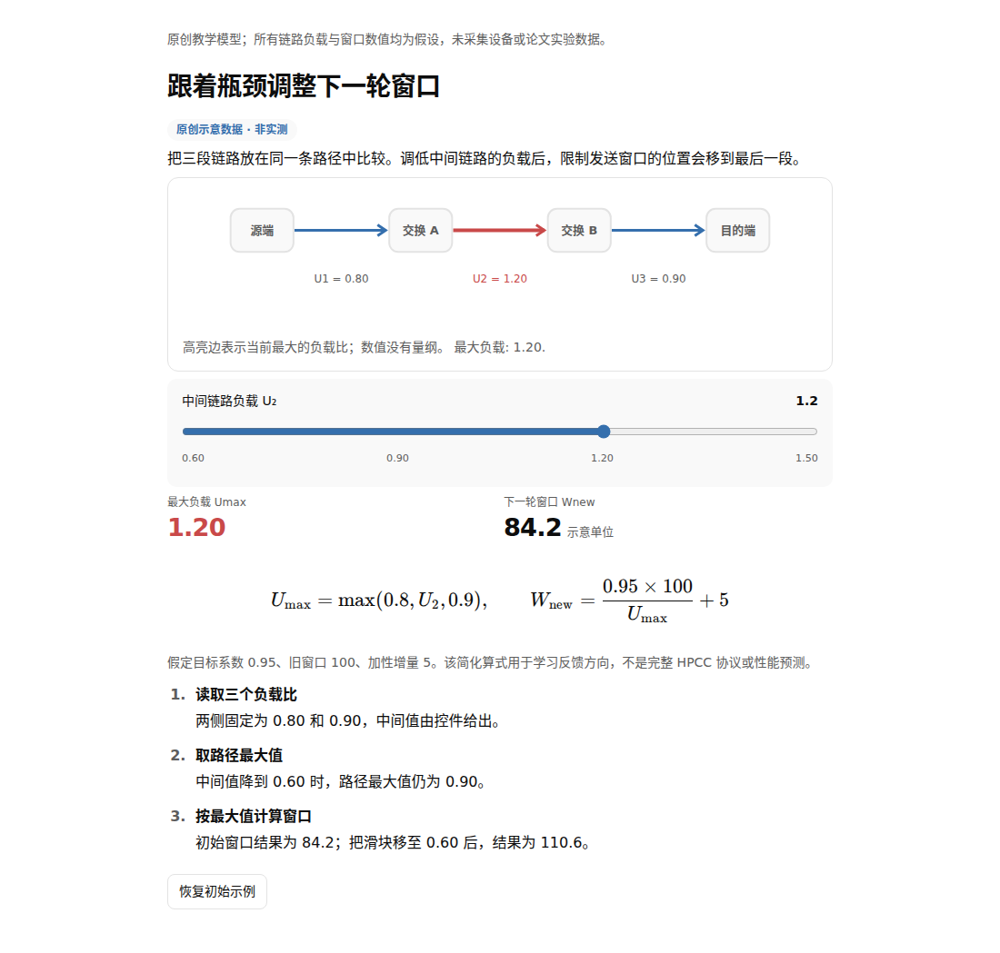
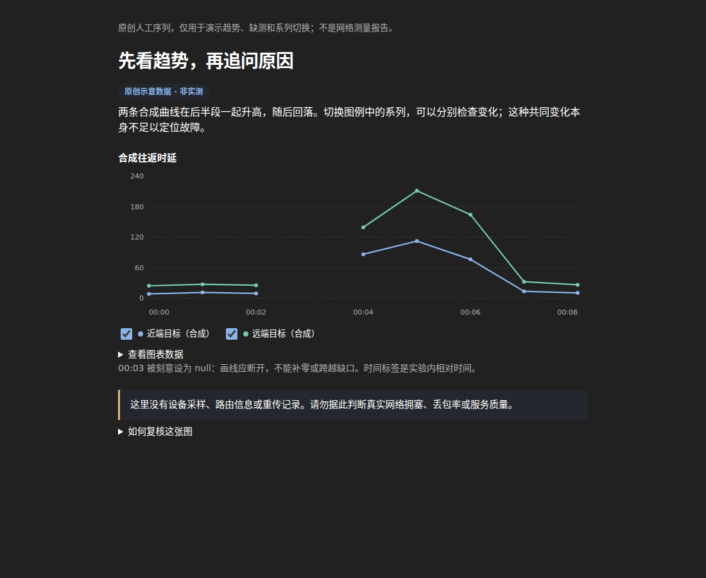

# Unified164 package ready for native acceptance

This tree contains the updated164-node CDN and schema package. Full local generation/build/CDN/type/queue/Node/public-type/boundary checks passed:3160/3160 Node tests,385.6 seconds. The earlier3147/3157 run is preserved; its ten historical assertion mismatches were repaired with strict reviewed projections and distinct-node assertions, without changing those old snapshots.

Canonical functionality:158 implemented (53 historical acceptances,105 pending full acceptance),1 partial Weather,97 missing. The source-built independent164 checks passed27 cases. The upcoming combined Chromium batch discovers717 tests; discovery is not execution. This version does not inherit native acceptance from the older154 package. AskUser work is excluded.

Use this checkout’s [ESM bundle](cdn/iui.min.js), [global bundle](cdn/iui.global.min.js), [stylesheet](cdn/iui.css), [schema](cdn/iui.schema.json) and [integrity manifest](cdn/integrity.json). All52 manifest entries are regenerated together. No package release or main-branch replacement is implied. Earlier source checkpoints below retain their historical identities.

# Unified164 functional source candidate

Canonical coverage is158 complete functional implementations (53 historical acceptances and105 pending full acceptance),1 partial Weather and97 missing. Protocol registration is164. ScheduledTaskSuggestion and the two Entity views passed13 independent cases; the repaired automation plan passed its14-case replay. These source-build checks do not claim new native/pixel acceptance.

The first unified local full run finished3147/3157: nine historical schema assertions needed the explicitly reviewed Link156 projection, and one historical person-profile assertion still expected the newly implemented Entity nodes to be absent. The original failure is preserved. Strict projection guards retain all old hashes and reject drift in either old or newly reviewed fields. A second complete local run and one combined native batch are required before publication of the new generated package.

# Current functional scope:155 /1 /100

The AutomationPlanSummary reset regression is repaired and its exact failing case now passes with14 independent cases and8 consumer flows on the fixed source. It is restored to implemented-pending. The prior scope rollback remains recorded below. Entity and Scheduled suggestions are still awaiting their independent functional decisions; protocol registration is164. New native/pixel results are pending.

# Current functional regression status:154 /2 /100

AutomationPlanSummary has a newly confirmed whole-plan-collapse/reset regression; its earlier13 passing cases did not cover that combination. DisplayAutomation and ListAutomations remain functionally implemented. A scoped repair and independent replay are required before restoring the plan status. Entity integration is a candidate only;164 protocol registrations do not increase this count. Earlier frozen checkpoints below retain their original results.

# Supplied scheduled-task suggestion candidate

One original finite suggestion view adds two local cancelable acceptance branches and a one-shot visible receipt. It performs no real scheduling or conversation operation. Registration is162; canonical coverage stays155/1/100 until independent functional review. Packaged CDN stays unified154. See [the contract](docs/scheduled-suggestion.md).

# Current functional scope:155 /1 /100

The three supplied automation views passed13 independent ordinary-function cases. Coverage is155 complete implementations (53 historical acceptances and102 pending full acceptance),1 partial Weather and100 missing;161 registered protocols. No real scheduling operations are implemented. Native/pixel acceptance remains separate. Packaged CDN stays unified154. Earlier checkpoints below retain their source identities.

# Supplied automation functional candidates

DisplayAutomation, ListAutomations and AutomationPlanSummary add three original finite supplied-data views and cancelable local requests. Registration is161; canonical coverage remains152/1/103 pending independent review of the new family. Packaged CDN remains unified154. No new native/pixel result is claimed. See [the contract](docs/automation-contract.md).

# Current functional scope:152 /1 /103

TabbedSection and VisualCardCarousel passed the original12 independent ordinary-function cases after the query-only card fix. Coverage is152 complete implementations (53 historical acceptances and99 pending full acceptance),1 partial Weather and103 missing;158 registered protocols. New native/pixel acceptance remains pending. Packaged CDN stays unified154. The preceding38d7 candidate had11/12 and is preserved in its original evidence.

# Supplied tabbed-section and visual-carousel source checkpoint

Two original functional candidates add horizontal/vertical sections with passive Markdown and measured visual card collections with image galleries and entity/URL requests. All36 family tests plus79 related compatibility/reset/Markdown/projection tests passed (115 total); build/types/queue/boundary checks passed. See [the contract](docs/tabbed-visual.md). Registration is158; canonical scope stays150 implemented,1 partial Weather,105 missing until independent review. No fresh CDN/native/pixel result is claimed; packaged CDN remains unified154. Earlier checkpoint statements below retain their original source identities.

# Current functional scope:150 /1 /105

The supplied Link family `e6b60a69` passed12 independent functional tests and an eight-flow consumer. Its three canonical IDs are now implemented-pending:150 implemented (53 historical acceptances,97 pending full acceptance),1 partial Weather and105 missing. Registration remains156. The public Link source ise90f0eb; packaged assets remain unified154. New native/pixel acceptance is separate. Earlier checkpoint statements below remain historical.

# Supplied Link-family source checkpoint

Three original supplied presentations are available: inline Link, LinkCard and RecommendationLinkCard, with phase handling, passive children, desktop URL/copy disclosure, explicit image loading and cancelable local host intents. The legacy value/href Link remains compatible. See [the contract](docs/supplied-links.md). Only two protocol registrations are new (156 total). Canonical scope remains147/1/108 pending independent review of these three new functional candidates. All47 Link-family tests and95 related compatibility tests passed (142 total); build/types/queue/boundary checks passed. Ten of11 schema-subset checks passed; the retained unified154 CDN intentionally differs from the new source schema, so its byte-identity check remains red until an identified asset rebuild. new native/pixel acceptance and matching CDN are separate. The previously published source isb4077ac and packaged CDN remains unified154. Earlier checkpoint statements below are historical.

# Current functional scope:147 /1 /108

The monthly spending source `7094076` passed eleven independent functional tests and is now implemented-pending. Current coverage is147 implemented (53 historical acceptances,94 pending full acceptance),1 partial Weather and108 missing. Registration remains154. This is a local source checkpoint; the latest public source remains `75a5115` and packaged assets remain unified154. Earlier checkpoint counts below are historical.

# Supplied monthly spending source checkpoint

The source adds monthly temporal series, explicit previous/average/month comparisons, original monotone interpolation, null-separated curves, day inspection, privacy masking and native reset. All50 spending compatibility/extension tests and33 shared reset contracts passed (83 total); build/types/queue/boundary checks passed. See [the typed contract](docs/spend-trends.md). Canonical scope remains146 implemented,2 partial,108 missing until independent Spend functional review. This local source has no new CDN/native result; public branch remains75a5115.

# Current functional scope: 146 / 2 / 108

Grid `8ade06a` passed nine independent functional tests and Upcoming `8446e16` passed ten. Both are now implemented-pending. Current coverage is146 implemented (53 historical acceptances,93 pending full acceptance),2 partial and108 missing. Registration stays154. These are local source extensions; the latest public source remains `75a5115` and its packaged assets remain unified154. No new native or pixel result is claimed. Earlier checkpoint numbers below describe their historical source.

# Upcoming flow source checkpoint

The source now supports supplied incoming/outgoing flows, stable top rows, conditional replacement by longer expanded lists, same-flow expansion retention, flow-change collapse, resolution/no-account states, explicit detail intents and native reset. See [the contract](docs/upcoming-flows.md). The42 Upcoming and33 shared reset tests passed,75 total, with types/boundary gates. The packaged CDN is still unified154; this extension has no new native result. Canonical scope remains144 implemented,4 partial,108 missing pending independent review.

# Image-grid presentation source checkpoint

The current source adds supplied mosaic rows and flex proportions, responsive recommendation More/Fewer, a passive four-image live layout, loading phases and an explicitly local viewer with cancellation, navigation, Escape and focus return. See [the contract](docs/image-grid-presentations.md). All43 Grid compatibility/extension tests passed; source types and boundary checks passed. A shared original five-image fixture is included. Two pending-loading backgrounds also now use the established tertiary surface role.

The packaged CDN stays on unified154. This source extension has no fresh native result. Current canonical scope remains144 implemented,4 partial,108 missing pending independent Grid functional review. Prior source and validation checkpoints below remain historical.

# Current canonical scope

FollowUpActionBar and ConversationSuggestions now have their supplied presentation, resolution and local intent branches, with independent ordinary functional review passed. Current scope is **144 implemented (53 historical acceptances and 91 awaiting full acceptance), 4 partial, 108 missing**. Protocol registration stays154. New native and reference-pixel acceptance is separate. The checkpoint descriptions below retain their original source/test boundaries.

# Conversation presentation source checkpoint

The current source adds supplied pending/resolved/failed states, decorative images, reference-informed pill layout and separate local voice/new-turn requests. Existing suggestions/prompt inputs remain compatible. See [the contract](docs/conversation-presentations.md). The 35 Conversation and 38 FollowUp tests passed in the current source build; no fresh full/native run is claimed. The packaged CDN remains unified154. Regenerate source and CDN with the documented commands below. Canonical counts remain142 complete,6 partial,108 missing pending independent complete-contract review.

# Follow-up presentation source checkpoint

The current source adds Footer and wrapped-pills layouts, responsive action selection, supplied pending/failed states, decorative images and three distinct local intent branches. The original flat form remains compatible. See [the contract](docs/follow-up-presentations.md).

This extension passed 38 targeted tests and build/type/public-boundary checks. It has not received a new full or native run. The packaged CDN remains the earlier unified154 asset. Regenerate with `npm run generate && npm run build`; use `npm run build:cdn` to produce matching CDN assets. Canonical counts remain142 complete,6 partial,108 missing pending complete-contract review. The historical unified154 results below apply to their fixed predecessor only.

# Current unified portable build

This checkout registers 154 protocol node types. Canonical reference scope is separate: **142 complete implementations (53 historically accepted and89 awaiting full acceptance), six partial and108 missing, out of256**. See [reference functional gaps](docs/reference-function-subsets.md). The five finite ActionBar, ConversationSuggestions, ImageGrid, UpcomingActivity and SpendMonth implementations remain partial because their complete reference contracts are not implemented.

## Rebuild this checkout

Use Node24.19.0 and the committed lockfile. Run `npm ci`, then `npm run check`. This regenerates schema/types, the official pinned Lottie adapter, all runtime bundles and CDN artifacts, then runs types, deferred-queue ownership, the full Node suite and public boundary checks. `node scripts/check-generated.mjs` verifies generated bytes against the committed checkout. Use `npx playwright test --config playwright.recovery.config.mjs` for the real-browser suite after installing the lock-pinned Chromium build and test font.

Preserve every tracked source, schema-construction input, package lock, example/test, license/NOTICE, the exact Noto test font and its license. The ignored generated Lottie JavaScript is recreated from official lottie-web5.13.0 by the hash-checked generator. No private frontend capture, external account connection or OpenAI runtime dependency is required. Finance labels and chart fractions are explicitly supplied; local intents never execute payments or send conversation messages.

The first unified154 Node run passed2854/2866; its12 failures were stale130-node registry/projection assertions. A scoped successor preserves all original definition hashes and relative order, freezes the exact154-node registry, and passed220 affected tests including two projection negative controls. The fresh unified154 check passed2868/2868 Node tests, types, public declarations, deferred-queue ownership and source-boundary checks; generated bytes match the committed snapshot. The last completed nativeCI is the older128 asset (2328Node/687Chromium), not this build.Discovery finds760 total browser tests; the recovery CI selects706 tests in78 files, excluding historical remote-pin suites. These706 tests have not yet executed. Historical consumer locks retain their original assets.

The original project overview follows.

<h1 align="center">Inform UI</h1>

<p align="center"><strong>让简短的 JSON，变成可阅读、可交互的科学解释。</strong></p>
<p align="center">正文 · 公式 · 图表 · 拓扑 · 联动控件</p>

<p align="center">
  <a href="https://github.com/Micraow/Inform-UI/actions/workflows/ci.yml"></a>
  <a href="LICENSE"></a>
  <a href="tsconfig.json"></a>
  <a href="package.json"></a>
</p>

<p align="center">
  <a href="#快速开始">快速开始</a> ·
  <a href="#一套库两种用法">两种用法</a> ·
  <a href="#示例">示例</a> ·
  <a href="#文档">文档</a>
</p>

Inform UI 是一套 **独立、开源的 JavaScript / TypeScript 界面库**。模型、应用或人只需提供结构化内容，库负责排版、公式、图表与交互。适合技术说明、教学演示、研究笔记，以及需要图文混排的 AI 回答。

**不需要 OpenAI 账号、API、服务或运行时。** 同一套库既能生成离线 HTML，也能嵌入你的网页。项目追求克制、清晰的编辑式科学表达。

## 独立项目声明 · Independence

Inform UI 是独立、非官方的社区实现，目标是高保真复刻 OpenAI Intelligent UI 的视觉与交互体验。本项目不由 OpenAI 开发、维护、赞助或认可。OpenAI、ChatGPT、Intelligent UI 等名称仅用于说明原始参考对象，不表示官方关联。第三方素材与代码仍受各自许可证和知识产权规定约束；本声明不代表获得了任何必要的第三方授权。

Inform UI is an independent, unofficial community implementation aiming to faithfully reproduce the visual and interactive experience of OpenAI Intelligent UI. It is not developed, maintained, sponsored, or endorsed by OpenAI. The names OpenAI, ChatGPT, and Intelligent UI identify the original reference only and do not imply an official affiliation. Third-party materials and code remain subject to their own licenses and intellectual property rights. This disclaimer does not provide any required third-party authorization.

## 看看效果

下面是本库从原创 JSON 生成的真实浏览器截图。拖动示例中的滑块，链路瓶颈与窗口数值会一起更新。

<p align="center">
  
</p>

<details>
<summary>查看深色模式与 RTT 图表</summary>
<br>
<p align="center">
  
</p>
</details>

截图中的数据均为示意，不是设备实测。图片来自本项目的合成示例与 Chromium 测试，未使用原版网站截图。[截图来源](docs/assets/README.md)

## 能做什么

- **自然的图文混排**：标题、正文、说明、卡片、列表、表格与步骤使用一致的排版和间距
- **科学内容表达**：带内置数学字体的公式、SVG 拓扑、折线/柱状/散点/面积/环图；区分分类、数值与时间坐标
- **可解释的交互**：滑块、开关、选择器和重置按钮，驱动声明式计算与联动指标
- **适应阅读环境**：亮色 / 深色主题、窄屏重排、键盘操作和图表数据表
- **一份 JSON，多处使用**：单文件离线 HTML、共享静态资源，或直接嵌入现有页面
- **有约束的内容协议**：提供 `iui/1` Schema、TypeScript 类型与运行时校验，不执行模型提供的 JavaScript

## 快速开始

### 网页聊天与浏览器：无需安装

把自包含的 Skill 和 `iui/1` 协议交给网页聊天模型，让它填写 JSON 和固定 HTML 壳。公开预构建库通过固定提交的 CDN 链接加载，页面不需要 Node 或构建工具。

→ [固定 CDN 链接、最小 HTML 壳与错误处理](docs/cdn.md)

Schema 也提供[按基础/领域读取的索引与闭包分片](docs/schema-subsets.md)：完整协议保留，常见领域包自动包含基础布局，混合领域可生成 union。

### 源码与本地 agent

需要 **Node.js 22+** 构建和使用 CLI。生成后的单文件 HTML 不需要 Node.js。

> 当前是源码开发预览，尚未发布 npm 包。以下命令使用已有实现的开发分支，不需要寻找同名 npm 包。

```sh
git clone --branch feat/portable-core-20261008 https://github.com/Micraow/Inform-UI.git
cd Inform-UI
npm ci --ignore-scripts
npm run build

node bin/iui.mjs validate examples/hpcc.json
node bin/iui.mjs build examples/hpcc.json --out output/hpcc.html --lang zh-CN
```

用浏览器打开 `output/hpcc.html`，就能拖动滑块、查看瓶颈变化和公式反馈。默认输出包含所需代码与样式，可以离线运行；远程图片需要阅读者主动加载。

## 一套库，两种用法

### 1. 生成独立 HTML

CLI 适合把模型输出保存成可直接打开、分享的页面：

```sh
node bin/iui.mjs build answer.json --out answer.html --lang zh-CN
```

也可以在 Node.js 中调用：

```js
import { readFile, writeFile } from 'node:fs/promises';
import { compileHtml } from './dist/index.js';

const answer = JSON.parse(await readFile('examples/hpcc.json', 'utf8'));
await writeFile('answer.html', await compileHtml(answer, { lang: 'zh-CN' }));
```

多页共用资源时，CLI 支持 `--assets shared`；将输出 HTML 和 `iui-assets/` 一起放到静态服务器即可。[编译与 CLI 说明](docs/api.md)

### 2. 嵌入你的网页

在通过 HTTP(S) 提供的页面中，使用构建后的浏览器模块：

```html
<div id="answer"></div>
<script type="module">
  import { mount } from './dist/browser.js';

  const controller = mount(document.querySelector('#answer'), {
    version: 'iui/1',
    state: { gain: 2 },
    computed: { result: { op: 'mul', args: [12, { $: 'gain' }] } },
    body: [
      { type: 'title', value: '调节增益，观察读数' },
      { type: 'slider', label: '增益', bind: 'gain', min: 1, max: 4, step: 1 },
      { type: 'metric', label: '合成读数', value: { $: 'result' }, unit: '示意单位' }
    ]
  });

  // controller.update(nextDocument); // 更新完整内容
  // controller.dispose();            // 页面卸载时清理
</script>
```

库默认注入有作用域的样式。已有样式管理或严格 CSP 的应用可自行加载 `dist/style.css`，并传入 `{ styles: false }`。[浏览器 API](docs/api.md#浏览器-api)

## 示例

| 示例 | 可以体验什么 |
| --- | --- |
| [链路瓶颈与反馈](examples/hpcc.json) | 拓扑高亮、滑块、公式与指标联动 |
| [RTT 时间序列](examples/rtt.json) | 两组曲线、缺测空档、图例开关与数据表 |
| [Wi-Fi 状态说明](examples/wifi.json) | 紧凑指标、单位和解释文字 |
| [工具短名单](examples/shortlist.json) | 原创缩略图、标题、摘要与链接混排 |
| [本地表单](examples/forms.json) | 输入/长文本/单选/分段控件、字段约束、提交与取消 |
| [天气领域视图](examples/weather.json) | 调用方供数、当地日期/℃℉/温度降水/图表表格切换 |
| [真实数值坐标](examples/numeric-charts.json) | 不等距/时间采样、五种图形与空/加载/错误状态 |
| [体育数据快照](examples/sports.json) | 当地日期赛程、比赛详情与记分牌、保留并列名次的积分排序 |
| [本地学习](examples/learning.json) | 单选/多选、解释计分与重试，闪卡翻面、自评与总结 |
| [金融快照](examples/finance.json) | 明确来源/时间、真实时间轴、相对共同基准比较（源码增量） |
| [金融热图](examples/heatmap.json) | 真实权重面积、行业筛选、涨跌色阶与完整表（源码增量） |
| [本地时间控件](examples/time.json) | 时区快照/设备时钟、秒表分圈、页内倒计时 |
| [提示与说明面板](examples/overlays.json) | 文本提示、非模态嵌套面板、焦点与关闭 |
| [组件组合](examples/kitchen-sink.json) | 当前接受节点的综合示例 |

想让 AI 生成这类 JSON，可搭配独立维护的 [Inform-UI-skill](https://github.com/Micraow/Inform-UI-skill)。核心库也可以单独使用。

## 当前支持范围

固定审计清单共256项，目前功能闭环已验53项、部分5项、已写待验30项、未实现168项；这不是全部组件完成声明，也不等于像素/全平台验收。[逐项进度与依据](docs/component-progress.zh-CN.md)

当前本地候选构建识别90种节点：**89种有限渲染合同、历史 `native` 输入明确拒绝**。Markdown为原创有限子集，标签页使用tab-group/tab-panel描述同一个canonical组件；当前推荐d370固定版仍是已验66节点，不能将新候选混作已验组件。开发分支图表新增数值/时间轴、散点、面积与环图，见[图表合同和版本边界](docs/charts.md)；地图、实时搜索、媒体服务和通用脚本应用尚未提供。

开发分支已实现表单、数值图表、天气，以及体育赛程/记分牌/积分榜。历史52节点CDN已包含体育、学习、金融与转换器组件，见[体育合同](docs/sports.md)。开发分支也提供本地测验/闪卡；金融快照/历史/比较与热图均已通过源码浏览器及截图验收；固定CDN入口见文档。更多领域变体仍待实现。这里不是全部 Intelligent UI 能力的完成声明。

`portable` 是现有 API 中的渲染方式名称；HTML 与嵌入网页是同一套库的用法，不是不同产品版本。后续能力沿独立公开实现扩展，历史私有桥接不属于产品路线。外部数据可来自本地或你选择的服务商。

完整边界见 [节点支持表](docs/support-matrix.md) 和 [52 项能力评估](docs/gallery-capabilities.md)。能力目录不代表已经全部实现。公式使用带明确许可的 KaTeX 数学字体，并保留无障碍 MathML。

本地新增[清单](docs/checklist.md)、[句中填空](docs/fill-blank.md)、[组句练习](docs/sentence-builder.md)，同版Schema与公共API已通过本地检查，等累计浏览器验收后再更新推荐CDN。

新增候选还有[本地词汇](docs/vocab-card.md)、[评分](docs/rating.md)、[供图标识](docs/favicon.md)、[供数日程](docs/agenda.md)和[显式宿主按钮动作](docs/button-actions.md)。[上一组整合记录](docs/local-enhancements-75.md)保留各项测试边界。

## 文档

- [无需安装的 CDN 使用](docs/cdn.md)
- [API 与 CLI 使用](docs/api.md)
- [JSON Schema](src/schema/iui.schema.json) · [TypeScript 文档类型](src/schema/document.d.ts)
- [节点支持表](docs/support-matrix.md) · [能力评估](docs/gallery-capabilities.md)
- [数值图表](docs/charts.md) · [天气数据契约](docs/weather.md) · [表单与操作契约](docs/forms.md) · [体育数据契约](docs/sports.md) · [测验与闪卡](docs/learning.md) · [金融数据契约](docs/finance.md) · [热图](docs/heatmap.md) · [视觉依据](docs/design-tokens.md)
- [安全与资源策略](docs/security.md)
- [开发指南](docs/development.md) · [架构决策](docs/architecture.md) · [验证记录](docs/verification.md)
- [更新日志](CHANGELOG.md) · [来源与素材说明](docs/provenance.md)

## 参与与许可

欢迎通过 [Issue](https://github.com/Micraow/Inform-UI/issues) 提交问题、示例和改进建议。开始修改前请阅读[开发指南](docs/development.md)。

源码采用 **[MIT License](LICENSE)**，第三方依赖保留各自许可，见 [Third-party notices](THIRD_PARTY_NOTICES.md)。`package.json` 的 `private: true` 仅防止误发 npm，不限制这份公开源码的使用。

项目现名为 Inform UI。为兼容现有文档，`iui/1`、全局 `IUI`、CLI `iui` 和既有 CSS 类保持不变；[品牌与协议兼容说明](docs/branding.md)。

开发分支新增[九类单位与汇率快照换算](docs/converters.md)，含温差/绝对温度、互换、重置、缺测和来源时间。167项Node与136项浏览器检查已通过，包含52节点固定CDN的实际file://载入、六组转换器交互，以及亮暗截图复核。

[富文本、网格跨度、引用与结构化表格](docs/foundations.md)、[时间控件](docs/time.md)、[提示/说明面板](docs/overlays.md)与[流式布局、图标和状态](docs/primitives.md)已通过62节点整合批次验收（292项Node、216项Chromium、42消费者视图）。[已验62节点组合页](https://github.com/Micraow/Inform-UI/blob/3d2c0ce23dd1532f2a6acd7f2c5ac6c697d08323/examples/browser/current-components.html)保持冻结。[当前组合HTML](examples/browser/current-components.html)与[JSON](examples/current-components.json)已通过新66节点同版浏览器与分发验收，见[浏览器文档](docs/cdn.md)。

[加载与占位](docs/loading.md)及[来源与链接卡](docs/source-cards.md)已通过338项Node、241项Chromium及42+18消费者视图；推荐固定CDN为d370的66节点版本。这四项计入53/256功能已验，[完整证据](docs/verification-66.md)。

本地候选累计七项：轮播、代码块、饼图、复选框、有限Markdown、原生日期与标签页，482项Node整合测试已过，尚待远端浏览器验收；[明确边界](docs/local-enhancements-68.md)。推荐试用文件仍固定在已验d370，后续约30个实际组件集中运行完整CI。

当前另有[供数菜单](docs/restaurant-menu.md)、[本地建议选择](docs/prompt-suggestions.md)、[额外原生字段标签](docs/label.md)、[供数人物档案](docs/person-profile.md)与[本地写作草稿](docs/writing-block.md)。[二十项本地冻结](docs/local-enhancements-80.md)明确本地证据和待验边界，推荐试用仍是已验d370。

后续新增[供数文章](docs/news-article.md)、[供数评论](docs/entity-reviews.md)、[供数时段选择](docs/restaurant-availability.md)与[讨论阅读](docs/reddit-thread-card.md)。[二十四项本地记录](docs/local-enhancements-84.md)保留原始证据。其后新增[显式动画/庆祝](docs/motion.md)与[邮件草稿/计划回顾](docs/draft-review.md)，[二十八项本地冻结](docs/local-enhancements-88.md)全库863项通过，仍未计入真实浏览器验收。

[三十项本地冻结](docs/local-enhancements-90.md)加入供数地点选择与逐图确认画廊，同时修复Forms祖先禁用与同步adapter生命周期边界。28项全库与后续影响面检查的证据分别列出；正式已验仍53项。
