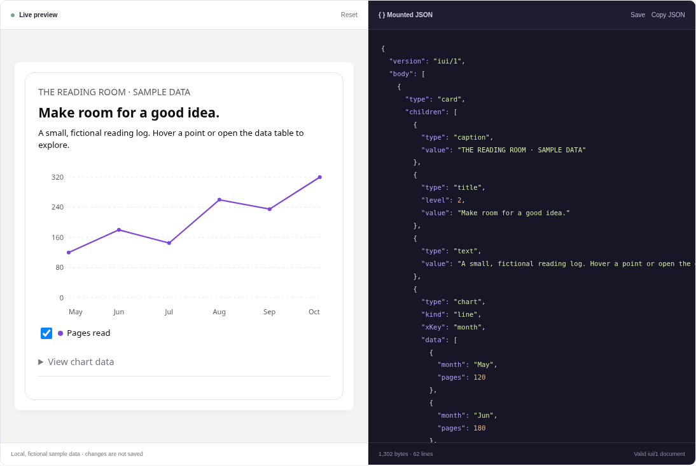

<div align="center">

# Inform UI

### 让结构化内容，成为真正可交互的界面。

用一份 JSON 表达文字、图表、公式、表单与领域卡片。
在浏览器中嵌入，也能生成独立 HTML。

[组件展示](docs/showcase.md) · [快速开始](#快速开始) · [浏览器接入](docs/cdn-218.md) · [API 文档](docs/api.md) · [配套 Skill](https://github.com/Micraow/Inform-UI-skill/tree/recovery/consumers-126-20261011)

**JavaScript / TypeScript · iui/1 · MIT · 无需账号或 API**

</div>

---

<p align="center">
  
</p>

## 从内容到界面

- **清晰表达**：一致的排版、卡片、表格、数学公式与 SVG 图形
- **真实交互**：表单校验、滑块联动、标签页、图表探索与本地练习
- **灵活交付**：嵌入已有页面，或导出带资源的独立 HTML
- **有据可查**：JSON Schema、TypeScript 类型、运行时语义校验，以及逐组件使用契约

## 组件展示

按分类或名称浏览全部 **218 个协议节点**，试用 **217 个可渲染示例**，查看并复制实际挂载的完整 JSON。`native` 作为明确的拒绝边界单独展示。

支持浅色 / 深色、小屏布局、状态重置、依赖关系与本地事件查看。[打开使用指南 →](docs/showcase.md)

## 验证状态

`main` / PR 检查实际提交的完整 Node、组件展示、合成浏览器用例，以及 Linux / Windows / macOS 可移植性。冻结的 prepared 115 历史批次从未完成验收，保留为独立手动复现工作流；其失败记录不计作当前源码通过。[覆盖范围与历史结果](docs/ci-validation.md)。

## 快速开始

需要 **Node.js 22+**。当前为源码开发预览，尚未发布 npm 包。

```sh
git clone --branch recovery/portable-124-20261011 https://github.com/Micraow/Inform-UI.git
cd Inform-UI
npm ci --ignore-scripts
npm run showcase
```

浏览器打开 **http://127.0.0.1:4175**，即可试用组件并获取 JSON。

只需编译一份独立页面：

```sh
npm run build
node bin/iui.mjs build examples/hpcc.json --out output/hpcc.html --lang zh-CN
```

生成后直接打开 `output/hpcc.html`。也可使用[固定版本的浏览器资源](docs/cdn-218.md)，无需本地构建。

## 一份最小 JSON

滑块改变本地状态，指标随之更新：

```json
{
  "version": "iui/1",
  "state": { "count": 3 },
  "body": [
    { "type": "title", "value": "阅读计划" },
    { "type": "slider", "label": "每日篇数", "bind": "count", "min": 1, "max": 10, "step": 1 },
    { "type": "metric", "label": "今日目标", "value": { "$": "count" }, "unit": "篇" }
  ]
}
```

在自己的页面中调用浏览器入口：

```js
import { mount, validateDocument } from './dist/browser.js';

const result = validateDocument(documentJson);
if (!result.ok) throw new Error(JSON.stringify(result.issues));

const controller = mount(document.querySelector('#app'), result.document);
// 不再使用时：controller.dispose();
```

## 按需深入

- [组件展示与静态构建](docs/showcase.md)：搜索、试用、JSON 下载与运行方法
- [浏览器接入](docs/cdn-218.md)：固定资源、完整性与版本边界
- [API 与 CLI](docs/api.md)：校验、挂载、状态更新与 HTML 编译
- [Schema 模块](docs/schema-source-modules.md)：90 个源模块及真实依赖关系
- [安全边界](docs/security.md)：受限表达式、URL 与内容校验
- [开发指南](docs/development.md)：构建、测试与贡献

## 使用边界

界面展示你提供的数据。金融、天气、出行等示例不连接实际服务；业务按钮默认发出本地请求事件，由宿主应用决定如何处理。医疗相关计算仅为有范围限制的软件演示，未经临床验证。协议节点数量不代表外部服务、临床能力或第三方产品的完整覆盖。

## 许可与独立声明

项目代码采用 [MIT](LICENSE)；依赖及素材遵守各自许可，见[第三方声明](THIRD_PARTY_NOTICES.md)与[来源说明](docs/provenance.md)。

Inform UI 是独立、非官方的社区实现，以 OpenAI Intelligent UI 的视觉与交互体验为参考；不由 OpenAI 开发、维护、赞助或认可。相关名称仅说明参考对象，不表示官方关联，也不授予第三方素材或代码的使用权。

Inform UI is an independent, unofficial community implementation inspired by the visual and interactive experience of OpenAI Intelligent UI. It is not developed, maintained, sponsored, or endorsed by OpenAI. Reference names imply no affiliation or third-party authorization.
