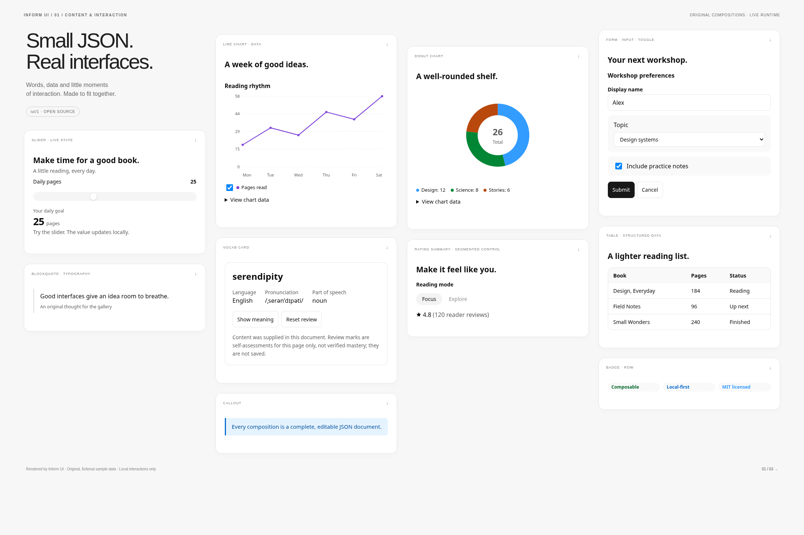
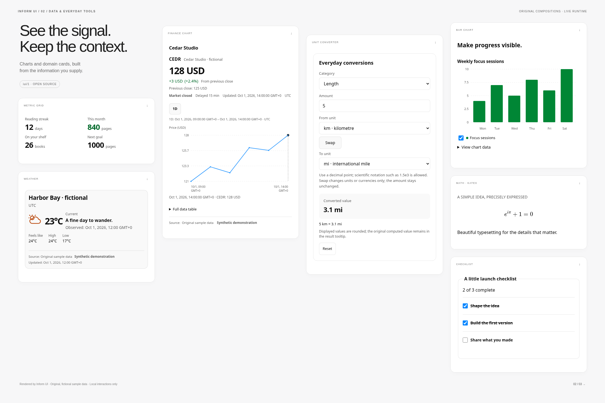
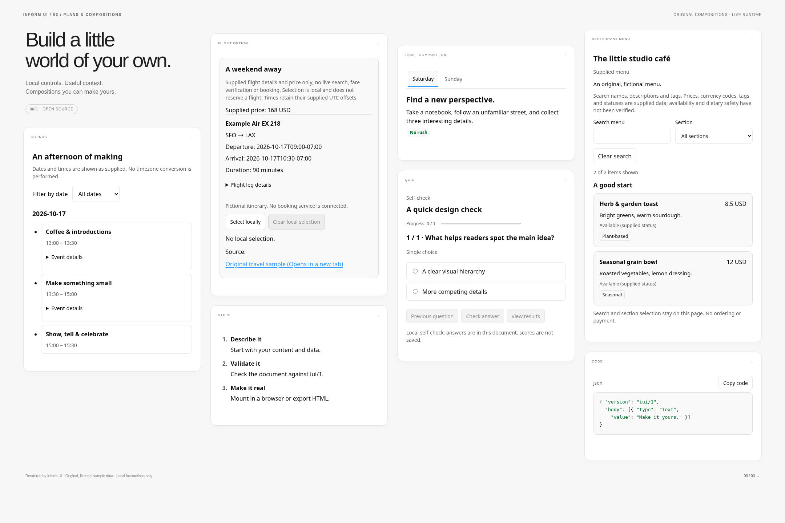

<div align="center">

# Inform UI

### Small JSON. Real interfaces.

用 JSON 构建清晰、可交互的内容。
图表、公式、表单与领域卡片，组合成可以直接交付的界面。

[组件展示](docs/showcase.md) · [快速开始](#快速开始) · [浏览器接入](docs/cdn-218.md) · [API 文档](docs/api.md) · [配套 Skill](https://github.com/Micraow/Inform-UI-skill)

**JavaScript / TypeScript · iui/1 · MIT · 无需账号或 API**

</div>

---

<p align="center">
  <a href="docs/assets/gallery-panorama.png"></a>
</p>
<p align="center">
  <a href="docs/assets/gallery-explore.png"></a>
  <a href="docs/assets/gallery-compose.png"></a>
</p>
<p align="center">
  真实运行库渲染 · 原创合成数据 · <a href="docs/assets/gallery-panorama.png">查看横向三页全景 →</a>
</p>

## 从内容到界面

- **清晰表达**：一致的排版、卡片、表格、数学公式与 SVG 图形
- **真实交互**：表单校验、滑块联动、标签页、图表探索与本地练习
- **灵活交付**：嵌入已有页面，或导出带资源的独立 HTML
- **有据可查**：JSON Schema、TypeScript 类型、运行时语义校验，以及逐组件使用契约

## 组件展示

三页横向画廊展示 **24 组原创组合、32 种节点**，包括阅读与表单、数据与工具、日程与旅行。每块内容都由同一运行库实时渲染，支持下载原始 JSON。启动后打开 **http://127.0.0.1:4175/gallery.html**。

按分类或名称浏览全部 **219 个协议节点**，试用 **218 个可渲染示例**，查看并复制实际挂载的完整 JSON。`native` 作为明确的拒绝边界单独展示。

布局主例单独展示纵向堆叠、横向排列、响应式网格，以及带上下文的分隔和留白。支持浅色 / 深色、小屏布局、状态重置、依赖关系与本地事件查看。[打开使用指南 →](docs/showcase.md)

## 验证与外观范围

`main` / PR 检查真实提交的完整 Node、展示页、合成浏览器用例，以及三平台可移植性。[CI 与历史复现](docs/ci-validation.md)。

展示页使用真实 renderer；当前控件修正涵盖只读评分摘要、分段选择及连续滑块。交互评分输入与 toggle 是本项目扩展，其余组件的原始外观对应仍在逐项审查，不宣称全库像素级复刻。[对齐范围](docs/control-alignment.md)。

## 快速开始

需要 **Node.js 22+**。当前为源码开发预览，尚未发布 npm 包。

```sh
git clone https://github.com/Micraow/Inform-UI.git
cd Inform-UI
npm ci --ignore-scripts
npm run showcase
```

浏览器打开 **http://127.0.0.1:4175/gallery.html** 看组合画廊，或打开 **http://127.0.0.1:4175** 逐个试用全部组件。

只需编译一份独立页面：

```sh
npm run build
node bin/iui.mjs build examples/hpcc.json --out output/hpcc.html --lang zh-CN
```

生成后直接打开 `output/hpcc.html`。也可使用[固定版本的浏览器资源](docs/cdn-218.md)，无需本地构建。

## 一份最小 JSON

滑块改变本地状态，指标随之更新：

```json
{
  "version": "iui/1",
  "state": { "count": 3 },
  "body": [
    { "type": "title", "value": "阅读计划" },
    { "type": "slider", "label": "每日篇数", "bind": "count", "min": 1, "max": 10, "step": 1 },
    { "type": "metric", "label": "今日目标", "value": { "$": "count" }, "unit": "篇" }
  ]
}
```

在自己的页面中调用浏览器入口：

```js
import { mount, validateDocument } from './dist/browser.js';

const result = validateDocument(documentJson);
if (!result.ok) throw new Error(JSON.stringify(result.issues));

const controller = mount(document.querySelector('#app'), result.document);
// 不再使用时：controller.dispose();
```

## 按需深入

- [组件展示与静态构建](docs/showcase.md)：搜索、试用、JSON 下载与运行方法
- [浏览器接入](docs/cdn-218.md)：固定资源、完整性与版本边界
- [API 与 CLI](docs/api.md)：校验、挂载、状态更新与 HTML 编译
- [Schema 模块](docs/schema-source-modules.md)：91 个源模块及真实依赖关系
- [安全边界](docs/security.md)：受限表达式、URL 与内容校验
- [开发指南](docs/development.md)：构建、测试与贡献

## 使用边界

界面展示你提供的数据。金融、天气、出行等示例不连接实际服务；业务按钮默认发出本地请求事件，由宿主应用决定如何处理。医疗相关计算仅为有范围限制的软件演示，未经临床验证。协议节点数量不代表外部服务、临床能力或第三方产品的完整覆盖。

## 许可与独立声明

项目代码采用 [MIT](LICENSE)；依赖及素材遵守各自许可，见[第三方声明](THIRD_PARTY_NOTICES.md)与[来源说明](docs/provenance.md)。

Inform UI 是独立、非官方的社区实现，以 OpenAI Intelligent UI 的视觉与交互体验为参考；不由 OpenAI 开发、维护、赞助或认可。相关名称仅说明参考对象，不表示官方关联，也不授予第三方素材或代码的使用权。

Inform UI is an independent, unofficial community implementation inspired by the visual and interactive experience of OpenAI Intelligent UI. It is not developed, maintained, sponsored, or endorsed by OpenAI. Reference names imply no affiliation or third-party authorization.
