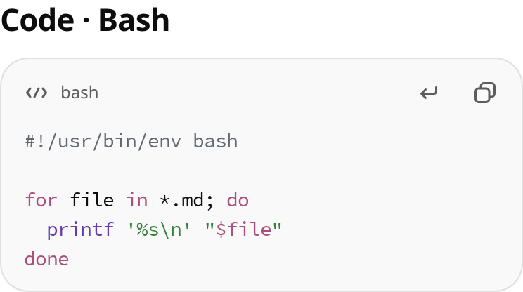
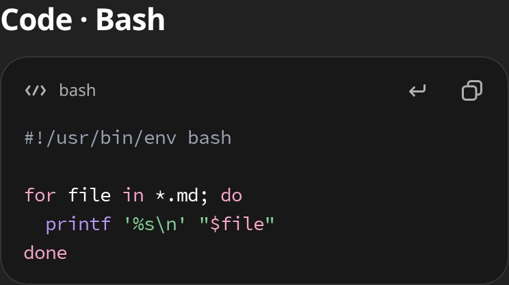
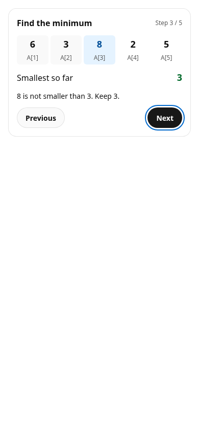
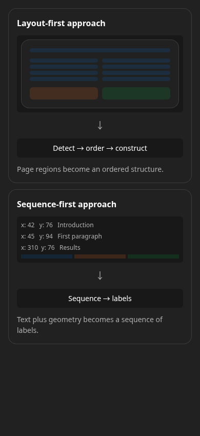

<div align="center">

# Inform UI

**把解释、数据与操作，放进一个可交互的界面。**

用简洁的 DSL 组合代码、图表、表单与卡片。
从一段可复制的代码，到能逐步探索的演示，都可以从基础组件开始。

[](LICENSE)
[](package.json)
[](package.json)
[](https://github.com/Micraow/Inform-UI/stargazers)

[快速开始](#快速开始) · [组合示例](#用基础组件讲清楚) · [接入文档](docs/v2/quick-start.md) · [配套 Skill](https://github.com/Micraow/Inform-UI-skill)

</div>

<p align="center">
  
  
</p>
<p align="center"><sub>真实组件截图 · 同一份 DSL · 浅色 / 深色主题</sub></p>

## 为什么用 Inform UI

- **让内容可以操作**：阅读目标用滑块调整，算法演示逐步前进，表单输入直接联动结果。
- **从通用积木开始**：文字、容器、等分布局与数据模板可以组合出结构图、步骤说明和左右对比。
- **保持风格一致**：共享主题、语义色、间距和 755 个 MIT 授权图标；Code 内置高亮、换行与复制控件。
- **方便嵌入与交付**：独立 JavaScript / TypeScript 库，可嵌入网页，也可生成内嵌运行库的离线 HTML。
- **给生成结果明确边界**：组件参数、Schema 与生成提示词来自同一份契约，方便人与智能体共同编写。

## 用基础组件讲清楚

下面的分层图由 `Box`、`Grid`、`Row`、`Text` 和 `Card` 组合。四层数据交给两层 `@Each`，每行自然生成 1、2、4、8 个等宽色块。

<p align="center">
  <a href="examples/v2/layered-work.openui"></a>
</p>

[查看完整 DSL](examples/v2/layered-work.openui) · [布局与语义色](docs/v2/design-foundations.md)

| 想表达什么 | 从哪里开始 |
| --- | --- |
| 带高亮、复制和换行的代码 | [Code 示例](examples/v2/code-bash.openui) |
| 数组高亮、当前值与说明 | [静态数组](examples/v2/array-overview.openui) |
| 上一步 / 下一步，结果随状态变化 | [交互步进](examples/v2/array-steps.openui) |
| 竖直步骤、箭头与过程说明 | [步骤流程](examples/v2/vertical-steps.openui) |
| 文档缩略图与两种处理方式的对比 | [组合对比](examples/v2/document-comparison.openui) |

<details>
<summary><strong>展开看交互步进与深色组合截图</strong></summary>

<p>
  
  
</p>

左图在实际点击、键盘前进与返回后捕获；右图的缩略图由基础组件组成。截图展示原创合成示例，详细来源见[素材说明](docs/assets/v2/README.md)。

</details>

## 快速开始

需要 **Node.js 22+**。当前为源码预览，尚未发布 npm 包。

```sh
git clone https://github.com/Micraow/Inform-UI.git
cd Inform-UI
npm ci --ignore-scripts
npm run showcase:next
```

直接打开生成的 `output/next/Inform-UI-Next-All-Components.html`，就能浏览组件、编辑 DSL、切换主题。展示页已内嵌运行库、样式与示例，无需本地服务器。

### 写一个会动的界面

用 `$pages` 声明本地状态。拖动滑块，目标文字随之更新：

```text
$pages = 20
root = Stack([
  Heading("每天读一点", 1),
  Text("拖动滑块，调整今天的阅读目标。", "muted"),
  Slider("每日页数", $pages, 5, 80, 5),
  Badge("今日目标：" + $pages + " 页", "info")
])
```

重复内容可以直接由数据生成：

```text
values = [6, 3, 8, 2, 5]
root = Stack([
  Grid(@Each(values, "value", Box([
    Text("" + value, "default", "center")
  ], {background: "surface", padding: "sm", radius: "sm"})), 5, "xs", "preserve")
])
```

### 嵌入网页，读取用户输入

构建后，将前面的 DSL 保存为字符串 `dsl`，在通过 HTTP 提供的网页中挂载：

```js
import { mount } from './dist/v2/inform-core.js';

const view = mount(document.querySelector('#app'), {
  source: dsl,
  theme: 'light',
});

// 随时读取；状态键保留 $ 前缀。
console.log(view.getSnapshot()?.state.$pages);

// 订阅后续变化，在宿主页面接上自己的业务逻辑。
const unsubscribe = view.runtime.subscribe(({ state }) => {
  console.log('新的阅读目标：', state.$pages);
});

window.addEventListener('pagehide', () => {
  unsubscribe();
  view.dispose();
}, { once: true });
```

输入与点击先更新页面内的状态。保存到服务端、交给智能体或回传聊天，需要宿主应用接入自己的回调与通信；独立 HTML 不会自动把结果发回聊天。

完整 HTML 壳与 API 见[接入指南](docs/v2/quick-start.md)。使用配套 [Skill](https://github.com/Micraow/Inform-UI-skill) 时，请让组件契约与运行库版本保持一致。

### 选择合适的入口

| 入口 | 适合的场景 |
| --- | --- |
| `dist/v2/inform-core.js` | 26 个注册组件：基础布局、文字、Code、输入控件、图标、媒体、表格及基础数据视图 |
| `dist/v2/inform-ui.js` | 全量 235 个注册组件，包含图表与领域视图，适合更丰富的展示 |

数量表示注册目录规模，不表示每个组合都经过完整验收。复杂排版仍需结合目标屏幕检查；数据、媒体授权及外部服务由宿主应用提供。

## 文档与更多示例

- [接入与运行](docs/v2/quick-start.md) · [DSL 语法边界](docs/v2/dsl-compatibility.md)
- [主题与组合](docs/v2/design-foundations.md) · [图标](docs/icons.md)
- [文档索引](docs/README.md) · [开发指南](docs/development.md)
- [安全边界](docs/security.md) · [更新日志](CHANGELOG.md)

<details>
<summary><strong>原有 iui/1 JSON API 与组件画廊</strong></summary>

`iui/1` JSON API、CLI 和画廊继续保留，与上面的 V2 DSL 使用不同输入语法。

[API / CLI](docs/api.md) · [画廊说明](docs/showcase.md)

<p>
  <a href="docs/assets/gallery-panorama.png"></a>
</p>

</details>

## 一起改进

欢迎在 [Issues](https://github.com/Micraow/Inform-UI/issues) 分享你想表达的内容、最小 DSL 与实际效果，也欢迎提交改进。医疗相关示例仅供展示，未经临床验证。

## 许可与独立性

[MIT](LICENSE) · [第三方许可](THIRD_PARTY_NOTICES.md) · [素材来源](docs/provenance.md)

Inform UI 是独立、非官方的 JavaScript / TypeScript 项目，使用明确声明许可的开源依赖。运行无需 OpenAI 账号、API 或服务；项目不由 OpenAI 开发、维护或认可。
